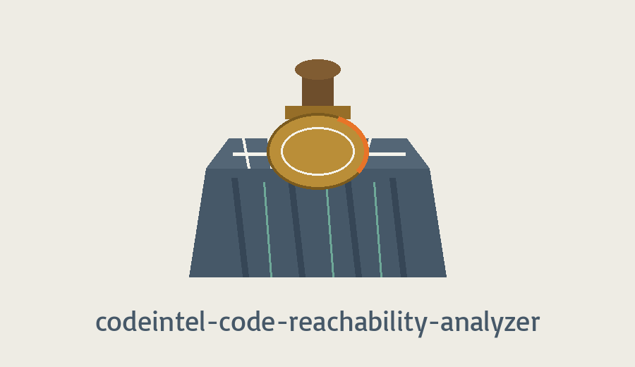
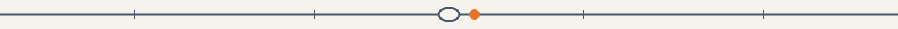
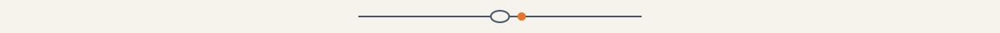

> Sack label plate: the medium line of the sorting office, ruled like a label. A tiny seal glyph sits beside this heading and no other.

# codeintel-Code-Reachability-Analyzer

A tool that analyzes code to identify potentially unreachable code blocks based on static analysis. This can help identify dead code and potential logical errors. Works on the Python AST directly, checking each statement list for statements after a return, raise, break or continue, and reports every following statement in that list, each with its own line. An exclusion entry naming a directory excludes everything under it, and exclusion entries are compared as normalised absolute paths. A named file that cannot be read or parsed produces an error result and the run exits 1. - Focused on Tools for static code analysis, vulnerability scanning, and code quality assurance

> **Pigeonhole inset: the division this tool makes.** The checking works on the Python AST directly, list by list. What sits after a return, raise, break, or continue in the same list has no route onward, and every following statement in that list is reported, each with its own line.

## Install
`git clone https://github.com/ShadowStrikeHQ/codeintel-code-reachability-analyzer`

> **Pigeonhole inset: clone line flagged.** The install line above points to ShadowStrikeHQ, not to ShadowGuard-AI. It is preserved as printed and flagged here, not quietly corrected.

## Usage
`./codeintel-code-reachability-analyzer [params]`

> **Pigeonhole inset: usage line flagged.** The usage line above is a placeholder. The README names no target file or directory argument at all, so a reader following the README alone would not know what to point the tool at.

## Parameters
- `-h`: Show help message and exit
- `-v`: No description provided
- `-e`: List of files or directories to exclude from analysis.

> **Pigeonhole inset: -v has no description in the README.** The parameter list above leaves -v undescribed, exactly as the README leaves it. The -e entry carries the directory exclusion rule: an entry naming a directory excludes everything under it, and entries are compared as normalised absolute paths.

## License
Copyright (c) ShadowStrikeHQ

> **Pigeonhole inset: copyright line flagged.** The closing line above reads Copyright (c) ShadowStrikeHQ, preserved as printed and flagged beside the install fault. A named file that cannot be read or parsed produces an error result and the run exits 1: that exit rule is stated in the opening paragraph above and is recorded here as the third matter these insets are reserved for.
